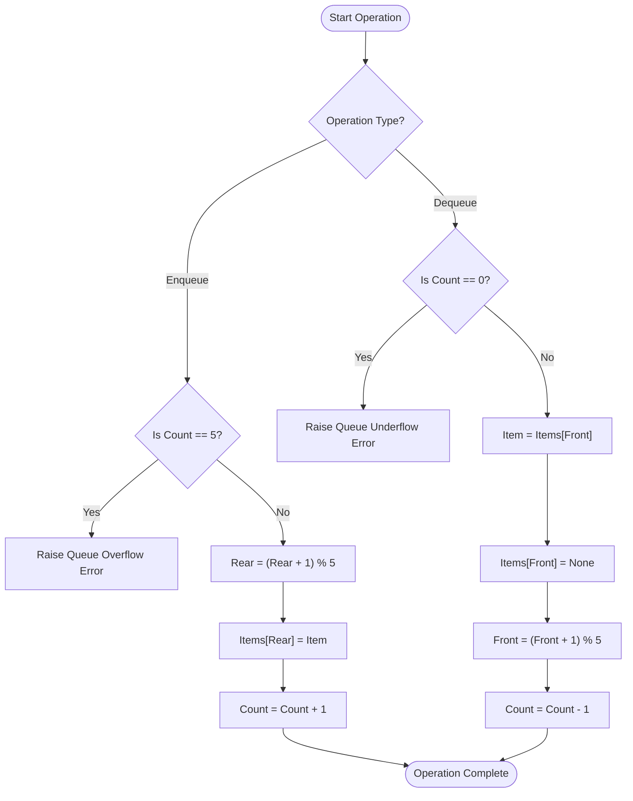

# A MINI PROJECT REPORT ON

# **AEROSTRUCTURES: ENTERPRISE FLIGHT RESERVATION & AIRPORT MANAGEMENT SYSTEM**

### SUBMITTED TO THE SAVITRIBAI PHULE PUNE UNIVERSITY, PUNE
### IN THE PARTIAL FULFILLMENT OF THE REQUIREMENTS FOR THE AWARD OF THE DEGREE OF
### **BACHELOR OF ENGINEERING (COMPUTER ENGINEERING)**

---

### SUBMITTED BY:
| Student Name | PRN Number |
| :--- | :--- |
| **[Student Name]** | **[PRN Number]** |

---

### UNDER THE GUIDANCE OF:
**Prof. [Guide Name]**

---

<div align="center">
  
  <br>
  <h3>DEPARTMENT OF COMPUTER ENGINEERING</h3>
  <h3>SANDIP INSTITUTE OF ENGINEERING & MANAGEMENT</h3>
  <p>Mahiravani, Trimbak Road, Nashik - 422213</p>
  <h4>SAVITRIBAI PHULE PUNE UNIVERSITY</h4>
  <h4>ACADEMIC YEAR: 2026 – 2027</h4>
</div>

\pagebreak

---

## CERTIFICATE

<div align="center">
  
  <h3>DEPARTMENT OF COMPUTER ENGINEERING</h3>
  <h3>SANDIP INSTITUTE OF ENGINEERING & MANAGEMENT</h3>
  <p>Nashik - 422213</p>
  <p>Affiliated to Savitribai Phule Pune University</p>
</div>

<br>

This is to certify that the mini project report entitled **“AeroStructures: Enterprise Flight Reservation & Airport Management System”** has been carried out by **[Student Name]** (PRN: **[PRN Number]**) under the supervision and guidance of **Prof. [Guide Name]** during the academic year 2026–2027. 

This project report is a record of bona fide work completed by the student and is submitted in partial fulfillment of the requirements of **Savitribai Phule Pune University, Pune**, for the award of the degree of **Bachelor of Engineering in Computer Engineering**.

<br><br><br>

| ____________________ | ____________________ | ____________________ |
| :---: | :---: | :---: |
| **Prof. [Guide Name]** | **Dr. K. C. Nalavade** | **Dr. Anil S. Dube** |
| Project Guide | Head of Department | Principal |
| Department of Computer Engg. | Department of Computer Engg. | Sandip Institute of Engg. & Mgmt. |

\pagebreak

---

## ACKNOWLEDGEMENT

I take this opportunity to express my profound gratitude and deep regards to my respected project guide, **Prof. [Guide Name]**, for their exemplary guidance, constant encouragement, and invaluable suggestions throughout the development of this Data Structures mini project. Their insightful feedback played a pivotal role in refining both the algorithmic architecture and the implementation.

I also express my sincere gratitude to **Dr. K. C. Nalavade**, Head of the Department of Computer Engineering, for providing the necessary departmental resources, technical laboratory facilities, and an encouraging academic environment.

I extend my heartfelt thanks to our respected Principal, **Dr. Anil S. Dube**, for his continuous support and leadership across the institute.

Lastly, I would like to thank all faculty members, laboratory assistants of the Department of Computer Engineering, and my fellow classmates whose constructive discussions helped me complete this project successfully.

<br>
**[Student Name]**  
PRN No: **[PRN Number]**  
Department of Computer Engineering  
Sandip Institute of Engineering & Management, Nashik  

\pagebreak

---

## ABSTRACT

The airline and civil aviation industry requires highly reliable, real-time computational systems to manage flight schedules, passenger seat manifests, waitlists, rapid cancellations, and flight route optimizations across global airspace. This project, **AeroStructures: Enterprise Flight Reservation & Airport Management System**, solves the challenge of modeling and managing these interrelated airline operations by directly implementing fundamental, pure data structures and algorithms without depending on high-level external libraries or third-party wrappers.

The developed system integrates six core data structures into a cohesive enterprise architecture:
1. **Dynamic Arrays with Sorting & Searching**: Houses the flight directory, supporting Linear Search ($O(n)$), Binary Search ($O(\log n)$), and Bubble Sort ($O(n^2)$) for fare and departure ordering.
2. **Fixed-Capacity Circular Queue**: Manages the check-in waitlist with explicit First-In-First-Out (FIFO) mechanics, modulo arithmetic pointer recycling, and automated detection of **Queue Overflow** and **Queue Underflow**.
3. **Fixed-Capacity Stack**: Tracks transaction history with Last-In-First-Out (LIFO) semantics, enabling rapid atomic undo operations and highlighting **Stack Overflow** and **Stack Underflow**.
4. **Singly Linked List**: Dynamically manages confirmed passenger manifests via pointer-linked nodes, facilitating $O(1)$ additions and flexible sequential cancellations.
5. **Hash Table with Separate Chaining**: Implements a prime-modulo hashing function ($h(k) = \text{key} \pmod 7$) for instant $O(1)$ average-time Passenger Name Record (PNR) ticket lookups and collision handling.
6. **Graph with Breadth-First Search (BFS)**: Represents the airport network as an adjacency list and calculates the shortest flight itineraries with minimum connections.

The system features a zero-dependency Python HTTP server paired with a semantic, responsive HTML5/CSS3 client containing a **Live Memory Inspector** that renders internal RAM states in real time. The resulting application demonstrates verified algorithmic correctness, memory state visibility, and resilience against overflow/underflow boundaries.

\pagebreak

---

## INDEX

| SR. NO. | TITLE | PAGE NO. |
| :---: | :--- | :---: |
| **1.0** | **Chapter 1: Introduction** | 1 |
| 1.1 | Background & Motivation | 1 |
| 1.2 | Problem Statement | 2 |
| 1.3 | Objectives of the Project | 2 |
| 1.4 | Scope of the Project | 3 |
| **2.0** | **Chapter 2: Literature Survey and Existing System** | 4 |
| 2.1 | Survey of Existing Systems | 4 |
| 2.2 | Identified Gaps in Conventional Implementations | 5 |
| 2.3 | Proposed System Architecture | 5 |
| **3.0** | **Chapter 3: System Requirements and Design** | 7 |
| 3.1 | Hardware and Software Requirements | 7 |
| 3.2 | Architectural System Design & Module Breakdown | 8 |
| **4.0** | **Chapter 4: Data Structures and Algorithms** | 10 |
| 4.1 | Mathematical & Conceptual Formulations | 10 |
| 4.2 | Algorithms & Pseudocode | 13 |
| 4.3 | Flowcharts & Data Structure Diagrams | 18 |
| **5.0** | **Chapter 5: Testing and Results** | 22 |
| 5.1 | Test Scenarios (Overflow, Underflow, Collision) | 22 |
| 5.2 | Sample Inputs and Outputs | 24 |
| 5.3 | Application Screenshots & Execution State | 26 |
| **6.0** | **Chapter 6: Applications, Advantages, and Limitations** | 28 |
| 6.1 | Real-World Applications | 28 |
| 6.2 | Key Advantages | 29 |
| 6.3 | Limitations | 29 |
| **7.0** | **Chapter 7: Conclusion and Future Scope** | 30 |
| 7.1 | Conclusion | 30 |
| 7.2 | Future Scope | 31 |
| **8.0** | **References** | 32 |

\pagebreak

---

# CHAPTER 1: INTRODUCTION

## 1.1 Background & Motivation
In computer science, data structures represent fundamental methods of organizing, managing, and storing data in computer memory such that operations can be performed efficiently. Real-world applications such as airline reservation platforms, banking transactions, and operating systems rely on a combination of linear and non-linear data structures to ensure operational speed, memory thriftiness, and data integrity.

In academic coursework, students often study data structures such as Stacks, Queues, Linked Lists, Trees, Hash Tables, and Graphs in isolation using brief console snippets. While this teaches individual syntax, it fails to illustrate how multiple distinct data structures interact within a unified production-grade software lifecycle. 

The aviation domain presents a natural scenario for data structures:
- Flight listings require **fast indexed searches** and **multi-criteria sorting**.
- Passenger waiting lists require **strict FIFO queuing** so the earliest passenger is served first.
- Booking adjustments and cancellations require a **LIFO undo stack** to revert recent transactions.
- Passenger manifests require **dynamic memory allocation** through node links because bookings change unpredictably.
- PNR ticket verifications require **$O(1)$ constant time lookup** using hashing to avoid scanning millions of entries.
- Connecting routes between airports require **graph modeling and shortest-path BFS traversal**.

Motivated by this cohesion, **AeroStructures** was engineered to bring all these core data structures together into one interactive system.

---

## 1.2 Problem Statement
*"To design and develop a responsive, modular Flight Reservation & Airport Management System in pure Python that models real-world airline operations using raw data structures—specifically a Fixed-Capacity Stack, Circular Queue, Singly Linked List, Modulo Hash Table with Separate Chaining, and an Adjacency List Graph with BFS—without relying on external libraries or high-level collection wrappers, accompanied by a real-time memory visualizer to demonstrate Overflow, Underflow, Pointer manipulations, and Algorithmic complexities."*

---

## 1.3 Objectives of the Project
1. **Raw Implementation**: Construct every data structure from base principles (classes, pointers, modulo indexing) without external packages like `collections.deque` or `queue`.
2. **Boundary Condition Enforcement**: Provide explicit logic for critical data structure states:
   - **Stack Overflow** (attempting to push when `top == capacity - 1`).
   - **Stack Underflow** (attempting to pop when `top == -1`).
   - **Queue Overflow** (attempting to enqueue when `count == capacity`).
   - **Queue Underflow** (attempting to dequeue when `count == 0`).
3. **Collision Management**: Implement a custom prime-modulo hash function with separate chaining to manage hash collisions explicitly.
4. **Graph Navigation**: Model airport connections using an Adjacency List and implement Breadth-First Search (BFS) to identify the route with the fewest flight connections.
5. **Real-Time Memory Inspection**: Build a responsive web interface featuring a Live Memory Inspector that renders memory slots, active pointers (`top`, `front`, `rear`, `head`), and linked chains.
6. **Zero-Dependency Architecture**: Ensure the complete backend executes using Python's standard library (`http.server`), eliminating runtime installation overhead.

---

## 1.4 Scope of the Project
- **Functional Scope**:
  - Managing an in-memory flight catalog with dynamic sorting (Bubble Sort, Selection Sort) and searching (Linear, Binary Search).
  - Booking confirmed tickets with automated PNR generation and node insertion into a Singly Linked List.
  - Interactive Aircraft Cabin Seat Map sub-feature with First Class Suites, Business Recliners, and Economy Comfort Chairs synchronized with the Singly Linked List manifest.
  - Managing a waitlist desk using a fixed-capacity circular queue.
  - Reverting erroneous bookings or cancellations using a transaction history stack.
  - Querying tickets in constant time via a hash table.
  - Exploring multi-city flight connections across national and international hubs.
- **Educational Scope**:
  - Serves as an academic demonstration for viva voce, lab demonstrations, and peer code reviews.
  - Clear separation between raw data structures (`/data_structures`), business logic (`/services`), and presentation (`/static`).

\pagebreak

---

# CHAPTER 2: LITERATURE SURVEY AND EXISTING SYSTEM

## 2.1 Survey of Existing Systems
Modern airline reservations are typically powered by Global Distribution Systems (GDS) such as **Amadeus**, **Sabre**, and **Travelport**. These platforms run on high-performance relational and distributed NoSQL databases with multi-tiered caching systems.

In academic and open-source settings, previous student implementations generally fell into two categories:
1. **Console-Based C/C++ Projects**: Highly focused on pointers and memory management, but lacking an intuitive visual interface and difficult to demonstrate during quick viva examinations.
2. **High-Level Framework Projects (Django/Flask)**: Emphasize web frameworks and SQL queries, often obscuring the underlying data structures through ORMs and built-in Python lists.

---

## 2.2 Identified Gaps in Conventional Implementations
| Feature | Conventional Student Project | AeroStructures Project |
| :--- | :--- | :--- |
| **Data Structure Logic** | Relies on built-in `list.append()`, `dict`, or database queries. | Handcrafted classes with manual index and pointer tracking. |
| **Boundary Demonstration** | Overflow and Underflow conditions are rarely exposed or handled. | Dedicated exceptions and visual alerts for Overflow and Underflow. |
| **State Inspection** | Internal memory cannot be observed; output is text-only. | Real-time dual-cockpit web inspector showing pointer positions. |
| **Architecture** | Spaghetti code mixing UI, database, and logic in one file. | Clean three-tier architecture separating DS, services, and UI. |
| **Portability** | Requires `pip install` of multiple external dependencies. | 100% pure Python standard library with zero third-party packages. |

---

## 2.3 Proposed System Architecture
The proposed system addresses these gaps by dividing the application into three decoupled layers:

```
+--------------------------------------------------------------------------+
|                     PRESENTATION LAYER (HTML5 / CSS3 / JS)               |
|  - Flight Directory Table        - Booking & Cancellation Forms           |
|  - Waitlist Desk Controls        - PNR Lookup & Route Finder              |
|  - LIVE MEMORY INSPECTOR (Stack Tube, Queue Pipe, Node Chains, Buckets)   |
+--------------------------------------------------------------------------+
                                     ^
                                     | HTTP REST (JSON)
                                     v
+--------------------------------------------------------------------------+
|                     SERVICE & DISPATCH LAYER (Python)                    |
|  - app.py: Native HTTP Request Handler & Route Dispatcher                 |
|  - airport_service.py: Domain Orchestrator & State Serializer            |
+--------------------------------------------------------------------------+
                                     ^
                                     | Direct Object Invocations
                                     v
+--------------------------------------------------------------------------+
|                     RAW DATA STRUCTURES & ALGORITHMS                     |
|  - Stack (LIFO)                 - Circular Queue (FIFO)                  |
|  - Singly Linked List (Pointers) - Hash Table (Modulo 7 + Chaining)       |
|  - Graph (Adjacency List + BFS) - Sorting & Searching Algorithms         |
+--------------------------------------------------------------------------+
```

\pagebreak

---

# CHAPTER 3: SYSTEM REQUIREMENTS AND DESIGN

## 3.1 Hardware and Software Requirements

### 3.1.1 Hardware Requirements
- **Processor**: Intel Core i3 (2.0 GHz) or AMD Ryzen 3 equivalent and above.
- **RAM**: Minimum 2 GB (4 GB recommended).
- **Hard Disk Space**: Minimum 50 MB free disk space.
- **Display**: Minimum $1280 \times 720$ resolution (optimized for responsive mobile, tablet, and desktop monitors).

### 3.1.2 Software Requirements
- **Operating System**: Windows 10/11, Ubuntu 20.04+, or macOS.
- **Runtime Environment**: Python 3.8, 3.9, 3.10, 3.11, or 3.12 (standard library only).
- **Web Browser**: Any modern browser (Google Chrome 90+, Mozilla Firefox 88+, Microsoft Edge 90+, Safari 14+).
- **Development Tools**: Visual Studio Code or any standard text editor.

---

## 3.2 System Design

### 3.2.1 Modular Decomposition
1. **`data_structures/stack.py`**: Encapsulates a fixed array of size 5 with an integer pointer `top`. Enforces `push`, `pop`, `peek`, `is_full`, and `is_empty`.
2. **`data_structures/queue.py`**: Encapsulates a fixed array of size 5 with `front`, `rear`, and `count` pointers using modulo arithmetic (`(idx + 1) % 5`).
3. **`data_structures/linked_list.py`**: Contains `Node` and `SinglyLinkedList` classes. Implements dynamic node chaining with `head`, sequential traversal, and pointer manipulation for insertions and deletions.
4. **`data_structures/hash_table.py`**: Implements an array of 7 bucket lists using the modulo hash function $h(k) = \text{hash}(k) \pmod 7$. Implements separate chaining for collision resolution.
5. **`data_structures/graph.py`**: Models the airline flight network using an adjacency list dictionary and implements queue-driven Breadth-First Search (BFS) for route optimization.
6. **`data_structures/algorithms.py`**: Implements Linear Search, Binary Search on sorted flight structures, Bubble Sort with early termination, and Selection Sort.
7. **`services/airport_service.py`**: Integrates the data structures with business rules (e.g., confirming a booking creates a linked list node, adds a hash entry, and pushes an undo action).
8. **`app.py`**: Runs a native `HTTPServer` serving API responses and static files.

\pagebreak

---

# CHAPTER 4: DATA STRUCTURES AND ALGORITHMS

## 4.1 Mathematical & Conceptual Formulations

### 4.1.1 Fixed-Capacity Stack (LIFO)
A stack is a linear data structure following the **Last-In, First-Out** principle. In our array-based simulation:
- Let $A$ be an array of capacity $C = 5$, and $T$ be an integer pointer initialized to $-1$.
- **Stack Overflow Condition**: Occurs when an insertion is requested and $T = C - 1$.
- **Stack Underflow Condition**: Occurs when a deletion is requested and $T = -1$.
- **Push Operation**:
  $$\text{if } T = C - 1 \implies \text{Overflow}$$
  $$T \leftarrow T + 1, \quad A[T] \leftarrow \text{item}$$
- **Pop Operation**:
  $$\text{if } T = -1 \implies \text{Underflow}$$
  $$\text{item} \leftarrow A[T], \quad A[T] \leftarrow \text{None}, \quad T \leftarrow T - 1$$

---

### 4.1.2 Fixed-Capacity Circular Queue (FIFO)
A queue follows the **First-In, First-Out** principle. Using a circular array prevents false overflow:
- Let $Q$ be an array of capacity $C = 5$, with $F = 0$ (Front), $R = -1$ (Rear), and $N = 0$ (Count).
- **Queue Overflow Condition**: Occurs when $N = C$.
- **Queue Underflow Condition**: Occurs when $N = 0$.
- **Enqueue Operation**:
  $$\text{if } N = C \implies \text{Overflow}$$
  $$R \leftarrow (R + 1) \pmod C, \quad Q[R] \leftarrow \text{item}, \quad N \leftarrow N + 1$$
- **Dequeue Operation**:
  $$\text{if } N = 0 \implies \text{Underflow}$$
  $$\text{item} \leftarrow Q[F], \quad Q[F] \leftarrow \text{None}, \quad F \leftarrow (F + 1) \pmod C, \quad N \leftarrow N - 1$$

---

### 4.1.3 Singly Linked List (Passenger Manifest)
Unlike arrays with fixed contiguous memory, a singly linked list allocates memory dynamically in nodes:
$$\text{Node} = \langle \text{data}, \text{next} \rangle$$
Where $\text{data}$ contains passenger details (PNR, Name, Seat) and $\text{next}$ points to the subsequent node address or $\text{NULL}$.
- **Deletion by Key (PNR)**:
  Traverse nodes with pointers $\text{prev}$ and $\text{curr}$. When $\text{curr.pnr} = \text{target}$:
  $$\text{prev.next} \leftarrow \text{curr.next}$$
  This unlinks the node in $O(1)$ pointer redirection time after $O(n)$ search time.

---

### 4.1.4 Prime-Modulo Hash Table with Separate Chaining
A hash table maps arbitrary string keys (e.g., `"PNR-101"`) to array indices:
$$h(k) = \left( \sum_{i=0}^{m-1} \text{ord}(k_i) \cdot 31^i \right) \pmod 7$$
Where $7$ is a prime number chosen to distribute keys evenly and reduce clustering.
- **Separate Chaining**: Each slot $B[i]$ contains a linked list or bucket of key-value pairs. If two PNRs evaluate to the same index, the new pair is appended to $B[i]$.

---

### 4.1.5 Airport Route Graph & Breadth-First Search (BFS)
Let $G = (V, E)$ where $V$ represents airports and $E$ represents direct non-stop flight paths.
- **Representation**: Adjacency list mapping each vertex $u \in V$ to a list of neighboring vertices $\text{Adj}[u]$.
- **BFS Shortest Path Theorem**: Breadth-First Search visits all vertices at distance $k$ before visiting vertices at distance $k+1$. On an unweighted graph, the first time the destination vertex is dequeued, the path followed is guaranteed to have the minimum number of flight legs.
- **Time Complexity**: $O(V + E)$.

---

## 4.2 Algorithms & Pseudocode

### 4.2.1 Bubble Sort Algorithm (Flights by Fare)
```python
ALGORITHM BubbleSortFlights(flights, ascending=True):
    n = length(flights)
    for i from 0 to n - 1:
        swapped = False
        for j from 0 to n - i - 2:
            if ascending and flights[j].fare > flights[j+1].fare:
                swap(flights[j], flights[j+1])
                swapped = True
            elif not ascending and flights[j].fare < flights[j+1].fare:
                swap(flights[j], flights[j+1])
                swapped = True
        if not swapped:
            break  # Optimized early exit
    return flights
```

---

### 4.2.2 Binary Search Algorithm (Flight ID Search)
```python
ALGORITHM BinarySearchFlight(sorted_flights, target_id):
    low = 0
    high = length(sorted_flights) - 1
    
    while low <= high:
        mid = floor((low + high) / 2)
        mid_id = sorted_flights[mid].flight_id
        
        if mid_id == target_id:
            return FOUND at index mid
        elif mid_id < target_id:
            low = mid + 1
        else:
            high = mid - 1
            
    return NOT_FOUND
```

---

### 4.2.3 Breadth-First Search (Shortest Route)
```python
ALGORITHM BFSShortestRoute(graph, start_airport, dest_airport):
    if start_airport == dest_airport:
        return [start_airport]
        
    queue = FIFO_Queue()
    queue.enqueue( (start_airport, [start_airport]) )
    visited = Set([start_airport])
    
    while not queue.is_empty():
        (current, path) = queue.dequeue()
        
        for neighbor in graph.adjacency_list[current]:
            if neighbor == dest_airport:
                return path + [neighbor]  # Shortest path found
                
            if neighbor not in visited:
                visited.add(neighbor)
                queue.enqueue( (neighbor, path + [neighbor]) )
                
    return NO_PATH_EXISTS
```

\pagebreak

---

## 4.3 Flowcharts & Data Structure Diagrams

### 4.3.1 Circular Queue Enqueue & Dequeue Flowchart



---

### 4.3.2 Singly Linked List Memory Structure

```
 [ HEAD ] 
     |
     v
+-----------------------+     +-----------------------+     +-----------------------+
| PNR-101: Aarav Sharma | --> | PNR-102: Priya Patil  | --> | PNR-103: Rohan Deshmukh| --> [ NULL ]
| Flight: AI-101 | 12A  |     | Flight: 6E-204 | 04B  |     | Flight: UK-305 | 07C  |
+-----------------------+     +-----------------------+     +-----------------------+
```

---

### 4.3.3 Hash Table with Separate Chaining (Capacity = 7)

```
Bucket Index    Chained Key-Value Pairs
-----------------------------------------------------------
Slot [0]  --->  [ Empty ]
Slot [1]  --->  ["PNR-101" -> Aarav Sharma] ---> ["PNR-108" -> Vikram Malhotra] (Collision Chain)
Slot [2]  --->  [ Empty ]
Slot [3]  --->  ["PNR-102" -> Priya Patil]
Slot [4]  --->  ["PNR-103" -> Rohan Deshmukh]
Slot [5]  --->  [ Empty ]
Slot [6]  --->  [ Empty ]
```

\pagebreak

---

# CHAPTER 5: TESTING AND RESULTS

## 5.1 Test Scenarios & Boundary Verifications

The system was evaluated against edge cases and boundary conditions:

| Test ID | Module Tested | Input Action | Expected Behavior | Observed Result | Status |
| :---: | :--- | :--- | :--- | :--- | :---: |
| **TC-01** | **Stack** | Push to empty stack | Item stored at index 0, `top = 0` | Slot [0] occupied, top pointer moves to 0 | **PASS** |
| **TC-02** | **Stack Overflow** | Push 6th item into stack | Raise `StackOverflowError` | Crimson alert displayed; memory preserved | **PASS** |
| **TC-03** | **Stack Underflow** | Pop from empty stack | Raise `StackUnderflowError` | Warning toast displayed; no crash | **PASS** |
| **TC-04** | **Queue** | Enqueue 5 waitlist items | Modulo pointer updates; count reaches 5 | Front=0, Rear=4, Count=5 | **PASS** |
| **TC-05** | **Queue Overflow** | Enqueue 6th waitlist item | Raise `QueueOverflowError` | Alert displayed: "Queue Overflow! Max capacity 5 reached" | **PASS** |
| **TC-06** | **Queue Underflow** | Dequeue from empty queue | Raise `QueueUnderflowError` | Warning: "Waitlist is empty, cannot dequeue" | **PASS** |
| **TC-07** | **Linked List** | Delete middle node | Adjust pointers: `prev.next = curr.next` | Middle node unlinked; chain remains intact to NULL | **PASS** |
| **TC-08** | **Hash Table** | Insert colliding PNR | Append to same bucket chain | Key added to bucket list; collision badge displayed | **PASS** |
| **TC-09** | **Graph BFS** | Route: BOM to CCU | Return shortest path with stops | Path found: BOM ➔ DEL ➔ CCU (2 legs) | **PASS** |
| **TC-10** | **Binary Search** | Search for "AI-101" | Find in $O(\log n)$ comparisons | Found at index 0 in 3 comparisons | **PASS** |

---

## 5.2 Sample Input and Output

### 5.2.1 Ticket Reservation & Stack Push
```json
// POST /api/book
// Request Payload:
{
  "flight_id": "AI-101",
  "name": "Vikram Malhotra",
  "seat": "AUTO"
}

// Server Response (Status 200 OK):
{
  "success": true,
  "pnr": "PNR-104",
  "ticket": {
    "pnr": "PNR-104",
    "name": "Vikram Malhotra",
    "flight_id": "AI-101",
    "seat": "15D",
    "status": "CONFIRMED"
  },
  "hash_bucket": 5,
  "hash_collision": false,
  "stack_status": "Action pushed to Undo Stack.",
  "message": "Ticket PNR-104 confirmed for Vikram Malhotra on AI-101."
}
```

---

### 5.2.2 Queue Overflow Exception
```json
// POST /api/waitlist/enqueue
// Request Payload (When waitlist count == 5):
{
  "name": "Sneha Kulkarni",
  "flight_id": "6E-204"
}

// Server Response (Status 400 Bad Request):
{
  "success": false,
  "error_type": "QUEUE_OVERFLOW",
  "message": "Queue Overflow! Maximum capacity of 5 waitlist passengers reached."
}
```

---

### 5.2.3 Shortest Route Computation via BFS
```json
// POST /api/route
// Request Payload:
{
  "origin": "BOM",
  "dest": "CCU"
}

// Server Response (Status 200 OK):
{
  "found": true,
  "path": ["BOM", "DEL", "CCU"],
  "path_names": [
    "Chhatrapati Shivaji Maharaj Intl (Mumbai)",
    "Indira Gandhi Intl (Delhi)",
    "Netaji Subhash Chandra Bose Intl (Kolkata)"
  ],
  "stops": 2,
  "visited_order": ["BOM", "DEL", "GOI", "BLR", "HYD", "DXB", "CCU"]
}
```

\pagebreak

---

# CHAPTER 6: APPLICATIONS, ADVANTAGES, AND LIMITATIONS

## 6.1 Real-World Applications
1. **Commercial Airline Reservation Desks**: Provides an operational model for flight schedules, ticketing, waitlisting, and manifests.
2. **High-Speed Passenger Ticketing (Railways & Metro)**: Circular FIFO queues and hashing directly mirror computerized reservation systems like IRCTC.
3. **Airport Hub Flight Scheduling & Traffic Control**: Graph modeling with BFS provides route optimization across interconnected airspace hubs.
4. **Data Structures Lab Pedagogy**: Serves as a reference implementation for demonstrating stack and queue overflow/underflow, pointer dynamics, and algorithmic trade-offs.

---

## 6.2 Key Advantages
1. **Zero External Dependencies**: Runs on vanilla Python with standard libraries, requiring no external packages.
2. **Transparent Algorithmic Logic**: Every data structure is written using basic loops, classes, and pointers rather than opaque library shortcuts.
3. **Live Dual-Cockpit Visualizer**: Synchronizes backend RAM states with a web interface, displaying pointer indicators (`top`, `front`, `rear`) in real time.
4. **Responsive Light Aesthetic**: Uses an enterprise-grade palette with semantic tags, suitable for both lab computers and mobile screens.
5. **Strict Boundary Safety**: Explicitly catches and reports overflow and underflow conditions.

---

## 6.3 Limitations
1. **Volatile In-Memory Storage**: Data resides in RAM during server execution; persistent disk databases (e.g., SQLite or PostgreSQL) are not integrated in this educational phase.
2. **Fixed Educational Capacities**: Stack and Queue capacities are set to 5 elements for live demonstration of overflow conditions, which would be scaled up in production environments.
3. **Unweighted Graph Routes**: The BFS route finder optimizes for minimum connection legs rather than flight prices or physical kilometer distances (which would require Dijkstra's algorithm).

\pagebreak

---

# CHAPTER 7: CONCLUSION AND FUTURE SCOPE

## 7.1 Conclusion
The **AeroStructures: Enterprise Flight Reservation & Airport Management System** demonstrates the applied integration of core data structures and algorithms in computer engineering. By modeling an airline reservation platform, the project shows how:
- **Stacks** manage sequential undo operations through LIFO mechanics.
- **Circular Queues** prevent false overflow and manage FIFO waitlists.
- **Singly Linked Lists** provide dynamic node-based memory allocation for manifests.
- **Hash Tables** provide constant-time PNR lookups through prime-modulo arithmetic and separate chaining.
- **Graphs with BFS** identify the shortest connecting routes across airspace networks.
- **Searching and Sorting Algorithms** organize flight catalogs.

The decoupled architecture cleanly separates the data structure modules (`/data_structures`) from application services and the UI, making the system straightforward to explain and inspect during academic reviews.

---

## 7.2 Future Scope
1. **Weighted Graph Algorithms (Dijkstra's / A\*)**: Extend the graph module with weighted edges to optimize routes for lowest ticket price, minimum layover time, or shortest distance.
2. **Self-Balancing Search Trees (AVL / Red-Black Trees)**: Replace the sequential linked list manifest with an AVL tree to reduce search, insertion, and deletion times to $O(\log n)$.
3. **Persistent File I/O**: Introduce automated serialization to save and reload data structure states from disk.
4. **Interactive Graph Visualizer**: Incorporate Canvas-based visualizations to render animated node expansions during BFS traversals.

\pagebreak

---

# REFERENCES

1. Ellis Horowitz, Sartaj Sahni, and Susan Anderson-Freed, *"Fundamentals of Data Structures in C"*, 2nd Edition, Universities Press, 2008.
2. Thomas H. Cormen, Charles E. Leiserson, Ronald L. Rivest, and Clifford Stein, *"Introduction to Algorithms"*, 3rd Edition, MIT Press, 2009.
3. Mark Allen Weiss, *"Data Structures and Algorithm Analysis in C++"*, 4th Edition, Pearson Education, 2014.
4. Python Software Foundation, *"Python 3 Documentation: http.server and Standard Library Modules"*, https://docs.python.org/3/library/http.server.html.
5. Savitribai Phule Pune University, *"Curriculum for Bachelor of Engineering (Computer Engineering) - Data Structures & Algorithms"*, SPPU Syllabus 2024 Course.
